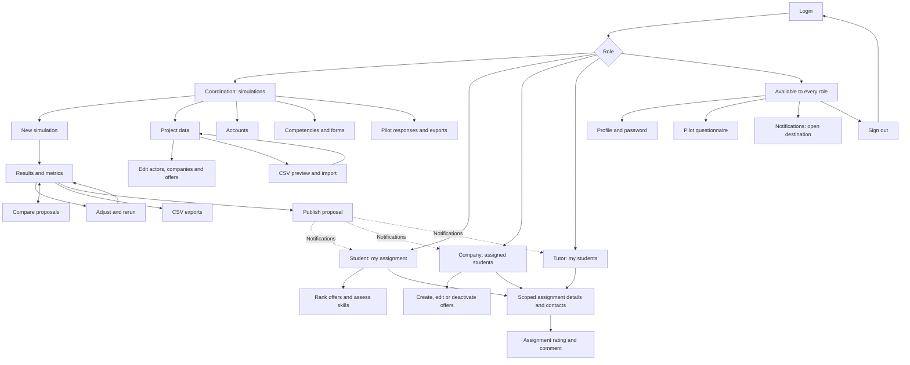

# Navigation

Login redirects each user to their role's home. The sidebar keeps daily work visible. Every protected page/action verifies role; assignment and company edits also verify record ownership. All roles have profile/password settings, pilot evaluation, notifications and sign-out.

| Role         | Pages and transitions                                                                                                                                                                                                           |
| ------------ | ------------------------------------------------------------------------------------------------------------------------------------------------------------------------------------------------------------------------------- |
| Coordination | `/simulaciones` → new dialog → `/simulaciones/[id]` → adjust/rerun, compare, export, publish. `/simulaciones/comparar` links back to either result.                                                                             |
| Coordination | `/datos?tab=estudiantes\|tutores\|empresas\|plazas` → `/datos/[type]/[id]` or `/plazas/[id]`; `/datos/importar` → preview → commit → data tab. New student/tutor → `/opciones/usuarios`; new company → `/datos/empresas/nueva`. |
| Coordination | Options → `/opciones/competencias` (catalog/forms) or `/opciones/usuarios` (accounts). `/evaluacion` includes responses, aggregates and export.                                                                                 |
| Student      | `/mi-asignacion` → `/asignaciones/[id]` (contacts); feedback on both views. `/preferencias` → catalog, ranking and competencies; link to profile logistics.                                                                     |
| Company      | `/asignados` → `/asignaciones/[id]` → feedback. `/plazas` → `/plazas/nueva` or `/plazas/[id]` → save/deactivate. Company details in profile.                                                                                    |
| Tutor        | `/mis-estudiantes` → `/asignaciones/[id]` → feedback. Capacity summary → profile availability.                                                                                                                                  |
| Everyone     | `/opciones/perfil` → personal details, role-specific location/capacity and password. `/evaluacion` → own questionnaire. Bell → event destination, marked read. Options → sign out → `/login`.                                   |

